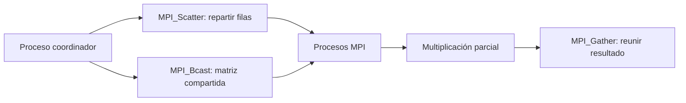

# MPI Matrix Benchmark — Multiplicación paralela de matrices

Laboratorio académico en **C++ y MPI** para experimentar con multiplicación de matrices cuadradas y estudiar el efecto de paralelizar trabajo entre procesos. El proyecto incluye código fuente, un gráfico histórico de resultados y herramientas de validación de mediciones.

> **Estado:** implementación de computación paralela para estudio. Las cifras históricas de rendimiento **no se han reproducido en esta revisión**; el archivo original de resultados mezcla datos tabulares con texto de matrices y debe normalizarse antes de usarlo como benchmark replicable.

## Arquitectura



El código utiliza operaciones colectivas de MPI para repartir y recuperar trabajo. La velocidad depende del tamaño de matriz, número de procesos, comunicación, compilador y hardware.

## Compilación y ejecución

**Requisitos:** compilador C++ con soporte MPI (por ejemplo OpenMPI o MPICH).

```bash
mpic++ Taller6.cpp -O2 -o matrix_mpi
mpiexec -n 4 ./matrix_mpi 500
```

El parámetro `500` representa el tamaño de matriz usado en el ejemplo histórico. En Windows, la sintaxis y herramientas pueden variar según la implementación MPI instalada. **No ejecutar en máquinas ajenas sin autorización ni medir rendimiento junto a cargas no controladas.**

## Estructura

| Recurso | Propósito |
|---|---|
| [`Taller6.cpp`](Taller6.cpp) | Implementación C++/MPI |
| [`GRAFICO_TALLER_FINAL.png`](GRAFICO_TALLER_FINAL.png) | Gráfico histórico |
| [`grafico.py`](grafico.py) | Herramienta de representación de resultados |
| [`resultados.csv`](resultados.csv) | Archivo histórico, no CSV tabular homogéneo |
| [`scripts/validate_results.py`](scripts/validate_results.py) | Validador de resultados normalizados |
| [`examples/measurements-example.csv`](examples/measurements-example.csv) | Mediciones **ficticias** para probar el validador |
| [`tests/`](tests/) | Pruebas de formato y consistencia |

## Resultados históricos y reproducibilidad

El informe original presenta un **speedup máximo informado de 2,44× con cuatro procesos** y matrices de 500×500. Ese valor es una afirmación histórica del trabajo académico, **no una medición nueva obtenida aquí**.


Para validar datos en el formato nuevo:

```bash
python scripts/validate_results.py examples/measurements-example.csv
python -m unittest discover -s tests -v
```

El ejemplo CSV de pruebas no debe presentarse como medición MPI. Los datos reales deben incluir tamaño, procesos, tiempos secuenciales/paralelos, speedup calculado, versión de MPI, compilador, CPU, memoria y varias repeticiones.

## Próximos hitos

- Recopilar mediciones limpias y reproducibles en distintas dimensiones de matriz.
- Validar resultados numéricos contra una implementación secuencial.
- Medir comunicación, sincronización, memoria y eficiencia `speedup / procesos`.
- Comparar sobrecarga por número de procesos sin inventar escalabilidad lineal.
- Automatizar compilación y pruebas MPI cuando el entorno esté definido.

[Protocolo de reproducibilidad](docs/BENCHMARK_REPRODUCIBILITY.md) · [Estudio de escalabilidad](docs/ARCHITECTURE_SCALABILITY_2026-11-04.md).

**Propósito:** aprendizaje técnico y científico, no servicio HPC empresarial certificado.
